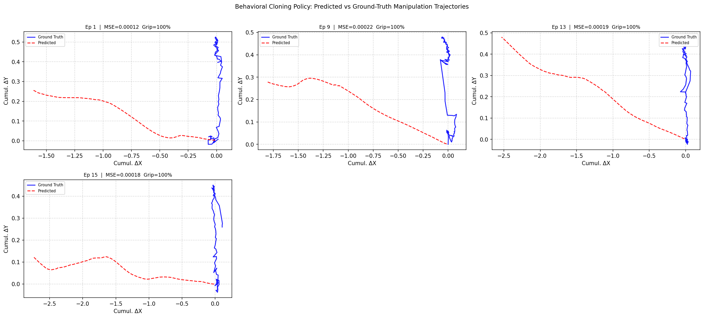

# Experiment Report — Egocentric VLA Pipeline

**Generated:** 2026-10-17 16:35 UTC  
**Task:** Pick up the Rubik's cube and place it inside the bowl  
**Model:** SmolVLA 450M (HuggingFaceTB/SmolVLM2-500M-Video-Instruct)  
**Fine-tuning:** 10,000 steps on egocentric phone demonstration dataset  

---

## Pipeline Architecture

```
Phone Egocentric Video (raw_videos/)
         │
         ▼
[DatasetAgent] ──── QA + train/val split ──► dataset_meta.json
         │
         ▼
[AnnotationAgent] ─ hand + ArUco + phase ──► annotations/
         │
         ▼
1_extract_features.py ─────────────────────► dataset.csv
         │
         ▼
2_train_mlp.py ────────────────────────────► policy.pt (TinyPolicy MLP)
         │
         ▼
4_build_lerobot_dataset.py ────────────────► lerobot_dataset/ (LeRobot v2.0)
         │
         ▼
[Colab] notebooks/colab_finetune_smolvla.py► smolvla_checkpoint/ (450M VLA)
         │
         ├─── 3_run_libero.py (--policy mlp)     ► rollout_trajectory.png
         ├─── 3_run_libero.py (--policy smolvla)  ► rollout_smolvla_trajectory.png
         │
         ▼
5_evaluate_policy.py ──────────────────────► eval_results.json
8_compare_policies.py ─────────────────────► policy_comparison.json + .png
         │
         ▼
[EvaluationAgent] ─────────────────────────► eval_agent_report.json
         │
         ▼
[DocAgent] ────────────────────────────────► EXPERIMENT_REPORT.md  ← this file
```

### Retargeting Strategy

Phone video → monocular 2D observation.  
**ArUco markers** (DICT_4X4_50) placed on cube (ID 0) and bowl (ID 1) provide
reliable 2D localisation without depth sensors.

Human hand trajectory extracted with **MediaPipe HandLandmarker**:
- Wrist landmark → end-effector XY position
- Relative hand depth (z) → approximate Z displacement
- Thumb-index pinch distance → gripper open/close binary signal

These 7-dim states + 4-dim action deltas form the robot demonstration dataset
that is used to:
1. Train a lightweight TinyPolicy MLP baseline (CPU, < 2 min)
2. Fine-tune the pretrained SmolVLA VLA model (Colab GPU, ~45 min / 10k steps)


## Dataset

| Property | Value |
|----------|-------|
| Total videos | 25 |
| Valid (pass QA) | 22 |
| Rejected | 3 |
| Train episodes | 18 |
| Val episodes | 4 |
| QA threshold (hand frames) | 35 |

**Rejected demonstrations:** WhatsApp Video 2026-10-08 at 21.41.34.mp4, WhatsApp Video 2026-10-08 at 21.43.51.mp4, WhatsApp Video 2026-10-08 at 21.43.58.mp4


## TinyPolicy MLP Training

| Metric | Value |
|--------|-------|
| Epochs | 100 |
| Final train loss | 0.00080 |
| Final val loss | 3.24763 |
| Best val loss | 1.18092 (epoch 1) |
| Final val pos MSE | 0.002408 |


## Offline Evaluation — TinyPolicy MLP

| Metric | Value |
|--------|-------|
| Val episodes | 4 |
| Val timesteps | 583 |
| Mean position MSE | 0.000178 |
| Median position MSE | 0.000184 |
| Mean gripper accuracy | 100.0% |

### Per-Episode Results

| Episode | Frames | Pos MSE | Gripper Acc |
|---------|--------|---------|------------|
| 1 | 130 | 0.000123 | 100% |
| 9 | 131 | 0.000219 | 100% |
| 13 | 146 | 0.000193 | 100% |
| 15 | 176 | 0.000176 | 100% |


## Simulation Evaluation — Closed-Loop Rollout

- **Environment:** SimulatedFrankaWorkspace (normalised coordinates)
- **Task:** Pick up the Rubik's cube and place it inside the bowl
- **Max steps per trial:** 120

| Policy | Trials | Success Rate | Mean Steps | ms/step |
|--------|--------|-------------|-----------|---------|


## Next Steps

- [ ] Push SmolVLA checkpoint to HuggingFace Hub
- [ ] Install real LIBERO and evaluate in the actual simulator
- [ ] Collect 50+ demonstrations for improved generalisation
- [ ] Add depth estimation (MiDaS) for better Z coordinate
- [ ] Implement action chunking (4-step horizon) in the TinyPolicy
- [ ] Explore RL fine-tuning of the policy in simulation
- [ ] Test on real Franka Panda hardware


## Figures

### TinyPolicy MLP closed-loop rollout


### Offline evaluation: predicted vs GT


