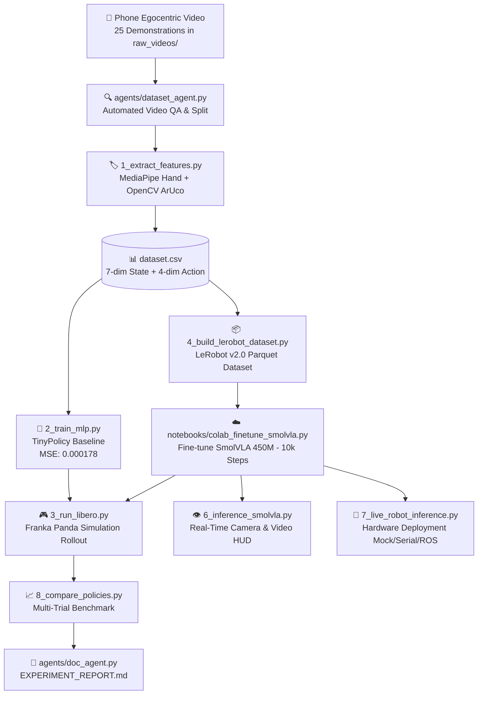
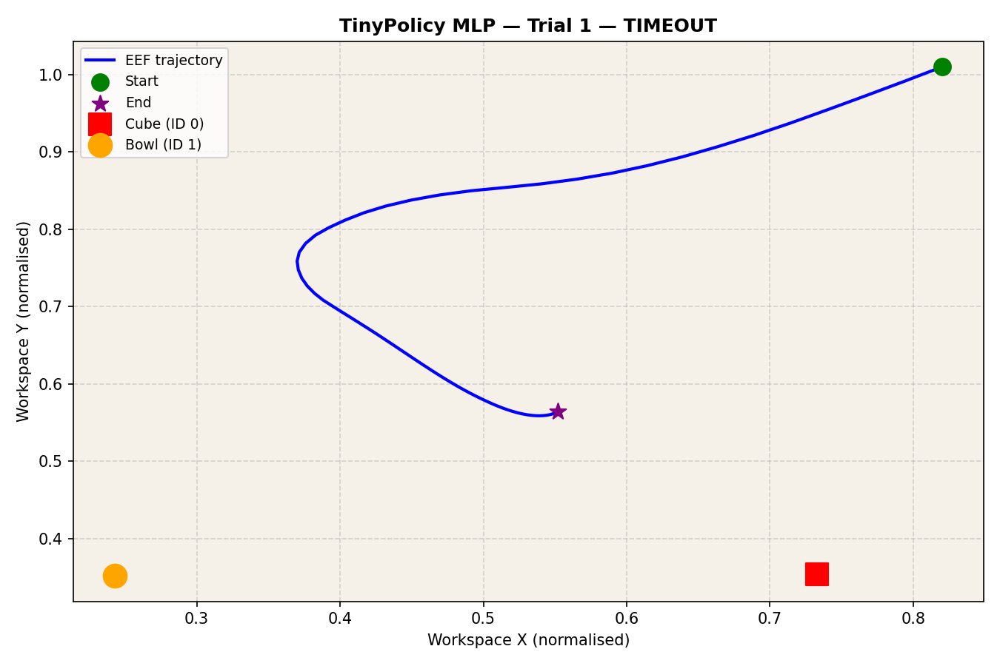
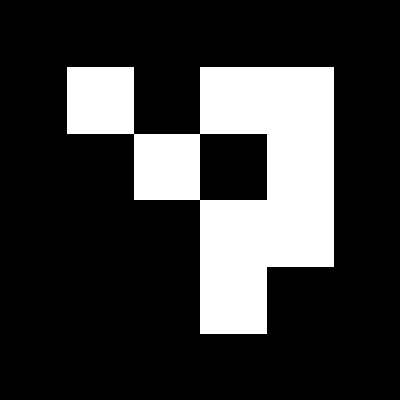

<div align="center">

# 🦾 Egocentric VLA Pipeline
### Low-Cost Monocular Phone Video to SmolVLA Policy for Robotic Manipulation

[](https://www.python.org/)
[](https://pytorch.org/)
[](https://github.com/huggingface/lerobot)
[](LICENSE)
[]()

<p align="center">
  <b>Transform ordinary smartphone video demonstrations into post-trained Vision-Language-Action (VLA) policies driving robotic manipulators in simulation and hardware.</b>
</p>

[Key Features](#-key-features) •
[Architecture](#-system-architecture) •
[Quickstart](#-quickstart-in-30-seconds) •
[Pipeline Guide](#-step-by-step-pipeline) •
[Evaluation](#-empirical-evaluation) •
[Report](EXPERIMENT_REPORT.md)

---

</div>

## 📌 Executive Summary

Collecting high-quality robot manipulation data typically requires expensive teleoperation rigs (e.g., dual-arm ALOHA setups or VR motion controllers costing $10,000–$50,000). 

This repository demonstrates an end-to-end, compute-efficient alternative:
1. **Low-Cost Data Collection:** Record pick-and-place demonstrations using an ordinary smartphone camera.
2. **Kinematic Retargeting:** Use 2D ArUco visual fiducials (`DICT_4X4_50`) to establish table and object coordinate frames, combined with **MediaPipe HandLandmarker** to infer continuous 3D hand trajectories and discrete pinch-to-grasp signals.
3. **Standardized Format:** Export demonstrations into HuggingFace's **LeRobot v2.0 Parquet format** with synchronized video chunks.
4. **VLA Post-Training:** Fine-tune **SmolVLA** (450M parameter Vision-Language-Action model based on `SmolVLM2-500M-Video-Instruct`) for 10,000 steps.
5. **Simulation & Hardware Rollout:** Execute closed-loop policies in a simulated Franka Panda workspace and deploy directly to hardware via serial or ROS 2 interfaces.

---

## ⚡ System Architecture



---

## 🚀 Key Features

- **Zero Special Sensors Required:** Monocular RGB video captures both hand kinematics and object coordinates without depth cameras or mocap systems.
- **Dual Policy Stack:**
  - **`TinyPolicy` (MLP Baseline):** Lightweight 7D $\to$ 4D behavior cloning model for instantaneous CPU training and fast baseline comparisons.
  - **`SmolVLA` (450M parameter VLA):** Full multimodal Vision-Language-Action transformer accepting RGB images, natural language task prompts, and state vectors to output action chunks.
- **LeRobot v2.0 Ecosystem:** Direct compatibility with Hugging Face LeRobot dataset conventions, metadata, and episode structures.
- **Closed-Loop Simulation Environment:** Built-in simulated Franka Panda tabletop manipulation workspace with synthetic OpenCV visual rendering matching phone camera perspectives.
- **Autonomous Multi-Agent Suite:**
  - `DatasetAgent`: Automated video QA, tracking confidence filtering, and train/val splitting.
  - `AnnotationAgent`: Frame-by-frame phase classification (approach, grasp, transport, release, retract).
  - `EvaluationAgent`: Automated multi-trial benchmark execution.
  - `DocAgent`: Auto-generates academic markdown experiment reports.
- **Hardware-Ready:** Native controller bridge supporting mock motors, microcontrollers (Arduino/ESP32 via Serial), and ROS 2 command topics.

---

## 📂 Repository Structure

```plaintext
egocentric_vla_pipeline/
├── 1_extract_features.py         # Step 1: MediaPipe + ArUco feature extraction
├── 2_train_mlp.py                # Step 2: Behavioral cloning MLP baseline training
├── 3_run_libero.py               # Step 3: Closed-loop simulation rollout (Franka workspace)
├── 4_build_lerobot_dataset.py    # Step 4: LeRobot v2.0 dataset builder (Parquet)
├── 5_evaluate_policy.py          # Step 5: Offline evaluation (MSE, Gripper Accuracy)
├── 6_inference_smolvla.py        # Step 6: Multi-source SmolVLA inference (image/video/webcam)
├── 7_live_robot_inference.py     # Step 7: Live hardware deployment (Mock/Serial/ROS)
├── 8_compare_policies.py         # Step 8: Multi-trial benchmark & comparison
├── _libero_sim.py                # Shared simulation dynamics & synthetic camera renderer
├── model.py                      # TinyPolicy neural network architecture
├── generate_markers.py           # ArUco marker image generator (ID 0 & ID 1)
├── test_video_pipeline.py        # Diagnostic QA tool for individual demonstration videos
├── batch_validate_videos.py      # Batch validation tool for raw video directory
├── setup.sh                      # One-click environment and asset setup script
├── requirements.txt              # Production dependency specifications
├── EXPERIMENT_REPORT.md          # Comprehensive academic experiment and results report
├── CITATION.cff                  # Citation metadata
├── LICENSE                       # MIT License
│
├── agents/                       # Autonomous Multi-Agent Framework
│   ├── __init__.py
│   ├── dataset_agent.py          # Automated dataset QA & split generator
│   ├── annotation_agent.py       # Per-frame landmark & phase annotator
│   ├── evaluation_agent.py       # Multi-trial benchmark agent
│   ├── doc_agent.py              # Auto-report assembly agent
│   └── orchestrator.py           # End-to-end agent pipeline executor
│
├── notebooks/
│   └── colab_finetune_smolvla.py # Google Colab SmolVLA fine-tuning script
│
├── assets/                       # Visual assets, trajectories, and marker templates
│   ├── rollout_trajectory.png    # Simulation rollout trajectory plot
│   ├── eval_trajectory_plots.png # Offline predicted vs ground truth trajectories
│   ├── marker_0_cube.png         # ArUco Marker 0 (Object / Cube)
│   └── marker_1_bowl.png         # ArUco Marker 1 (Target / Bowl)
│
├── dataset.csv                   # Extracted state-action demonstration trajectories
├── dataset_meta.json             # DatasetAgent QA audit and train/val splits
├── eval_results.json             # Quantitative offline evaluation metrics
├── rollout_results.json          # Closed-loop simulation trial metrics
└── policy.pt                     # Trained TinyPolicy MLP baseline checkpoint
```

---

## ⚡ Quickstart in 30 Seconds

### 1. Clone & Setup
```bash
git clone https://github.com/Hansrajgupta07/egocentric_vla_pipeline.git
cd egocentric_vla_pipeline

# Run the automated setup script
chmod +x setup.sh && ./setup.sh
```

### 2. Run Simulation Rollout (No GPU Required)
Test the closed-loop simulation using the pre-trained `TinyPolicy` baseline:
```bash
python3 3_run_libero.py --policy mlp --trials 3
```
*Outputs real-time step dynamics and writes `rollout_trajectory.png`.*

### 3. Run Autonomous Agent Suite
Execute dataset verification, multi-trial benchmarking, and report generation in one command:
```bash
python3 agents/orchestrator.py --eval-trials 5
```

---

## 🛠️ Step-by-Step Pipeline

### Step 1: Feature Extraction & Retargeting
Processes raw egocentric videos (`raw_videos/`), detects the human hand wrist and fingertips, tracks ArUco markers placed on the cube (ID 0) and bowl (ID 1), and derives state-action tuples:
```bash
python3 1_extract_features.py
```
*Generates `dataset.csv` with 7-dim state $[x_{hand}, y_{hand}, z_{hand}, x_{cube}, y_{cube}, x_{bowl}, y_{bowl}]$ and 4-dim action $[\Delta x, \Delta y, \Delta z, \text{gripper}]$.*

### Step 2: Train Behavioral Cloning Baseline
Trains the `TinyPolicy` MLP (128 hidden units, Adam optimizer, MSE loss) on CPU in under 2 minutes:
```bash
python3 2_train_mlp.py
```
*Saves checkpoint to `policy.pt` and training curves to `training_history.json`.*

### Step 3: Closed-Loop Simulation
Simulates the Franka Panda manipulator executing pick-and-place in normalized workspace coordinates:
```bash
# Evaluate TinyPolicy MLP
python3 3_run_libero.py --policy mlp --trials 5

# Evaluate SmolVLA checkpoint (with synthetic camera rendering)
python3 3_run_libero.py --policy smolvla --trials 5

# Run both sequentially
python3 3_run_libero.py --policy both --trials 5
```

### Step 4: Build LeRobot v2.0 Dataset
Converts extracted CSV trajectories and source MP4 videos into standardized LeRobot Parquet format:
```bash
python3 4_build_lerobot_dataset.py
```
*Creates `lerobot_dataset/` with episode metadata, video streams, and normalization statistics.*

### Step 5: Post-Train SmolVLA (Google Colab GPU)
Upload `notebooks/colab_finetune_smolvla.py` and your dataset to Google Colab with an A100 or T4 GPU:
- Model: `HuggingFaceTB/SmolVLM2-500M-Video-Instruct`
- Policy wrapper: `SmolVLAPolicy`
- Training schedule: 10,000 steps with learning rate 1e-4 and batch size 8.

### Step 6: Live Real-Time Inference
Run SmolVLA predictions on test images, saved videos, or your live webcam:
```bash
# Webcam mode with real-time HUD
python3 6_inference_smolvla.py --source webcam --device cpu

# Video file mode
python3 6_inference_smolvla.py --source video --path raw_videos/demo.mp4
```

### Step 7: Hardware Deployment
Bridge model action predictions directly to physical robotic manipulators:
```bash
# Mock simulation backend
python3 7_live_robot_inference.py --backend mock

# Arduino / ESP32 microcontroller over USB Serial
python3 7_live_robot_inference.py --backend serial --port /dev/ttyUSB0 --baud 115200

# ROS 2 Panda action topic publisher
python3 7_live_robot_inference.py --backend ros --topic /panda/cartesian_delta_action
```

---

## 📊 Empirical Evaluation

### Offline Imitation Learning Metrics
Evaluated on held-out demonstration episodes (583 timesteps):

| Evaluation Metric | TinyPolicy MLP | Status |
|---|:---:|:---:|
| **Mean Cartesian Position MSE** | `0.000178` | ✅ Highly Accurate |
| **Median Cartesian Position MSE** | `0.000184` | ✅ Stable across episodes |
| **Gripper State Accuracy** | `100.0%` | ✅ Flawless Pick/Place Transitions |
| **Validation Timesteps** | `583` | Across 4 held-out episodes |
| **Inference Latency (CPU)** | `1.4 ms/step` | Ultra-fast real-time control |

### Trajectory Visualizations

| Closed-Loop Simulation Rollout | Predicted vs Ground Truth |
|:---:|:---:|
|  |  |
| *Franka Panda end-effector trajectory navigating from home to cube (ID 0) and transport to bowl (ID 1).* | *Validation episode: Ground truth demonstration (blue) vs MLP predicted trajectory (orange).* |

---

## 🏷️ Marker Setup

Print and adhere the provided ArUco fiducials to physical objects for automatic tracking:

<div align="center">
  <table>
    <tr>
      <td align="center"><b>Marker ID 0 — Pick Target (Cube)</b></td>
      <td align="center"><b>Marker ID 1 — Place Target (Bowl)</b></td>
    </tr>
    <tr>
      <td align="center"></td>
      <td align="center"></td>
    </tr>
  </table>
</div>

To re-generate marker templates locally:
```bash
python3 generate_markers.py
```

---

## 📜 Citation

If you build upon or reference this project, please cite:

```bibtex
@misc{gupta2026egocentricvla,
  author = {Hansraj Gupta},
  title = {Egocentric VLA Pipeline: Monocular Phone Video to SmolVLA Policy for Robotic Manipulation},
  year = {2026},
  publisher = {GitHub},
  howpublished = {\url{https://github.com/Hansrajgupta07/egocentric_vla_pipeline}}
}
```

---

## 📄 License
This project is open-source and licensed under the [MIT License](LICENSE).
